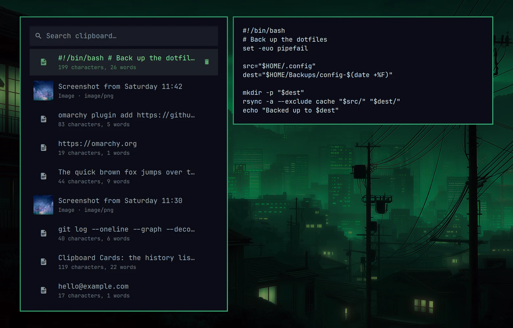
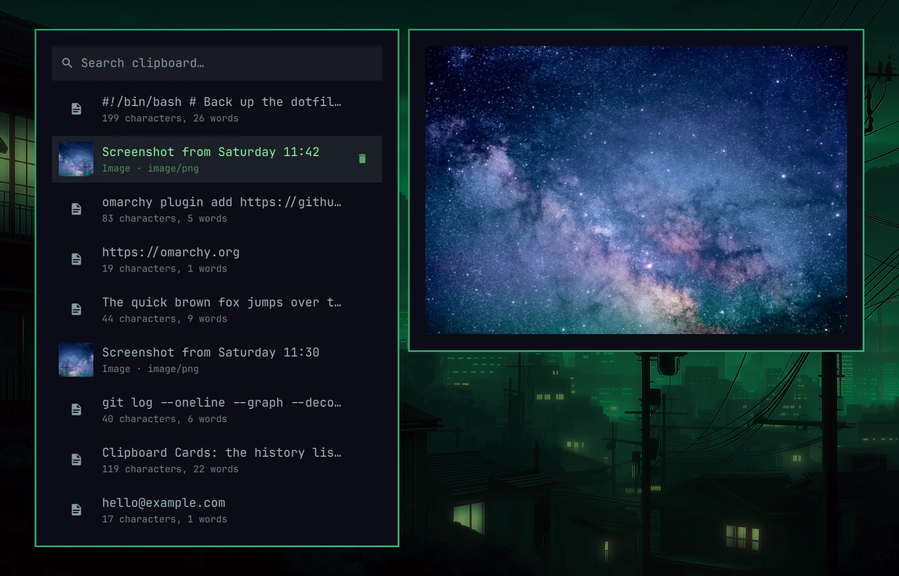

# Omarchy Clipboard Cards

[Omarchy](https://omarchy.org)'s clipboard manager with a card layout: the
history list in one card, and a separate preview card beside it that is only
as tall as what it shows.





It is Omarchy's own clipboard plugin with a different layout. Recording, the
history file, and the paste, copy and open commands are Omarchy's, unchanged.
Colours, border, font and corner radius come from your theme.

## What is different from the stock clipboard manager

- The list and the preview are two cards side by side instead of one card
  split in half.
- The preview card fits its content: the whole text of the selected entry, or
  the image at its own aspect ratio, up to the height of the list.
- Each row has an icon or an image thumbnail, the entry on one line, and a
  detail line under it (character and word count, or the image type).
- The selected row has a delete button.
- Long text in the preview scrolls with the mouse wheel or
  `Shift + Up` / `Shift + Down`.

## Requirements

- Omarchy with its shell running. Built and tested on Omarchy 4.0.4.

## Install

```bash
omarchy plugin add https://github.com/ggregoro/Omarchy-Clipboard-Cards.git --enable
omarchy restart shell
```

Enabling it switches Omarchy's built-in clipboard plugin off and routes
`SUPER + CTRL + V` to this one. Nothing in your Hyprland config changes.

If you have already cloned the clipboard plugin yourself
(`omarchy plugin clone omarchy.clipboard`), disable that clone first.

## Update

```bash
omarchy plugin update ggregoro.clipboard-cards
omarchy restart shell
```

## Remove

```bash
omarchy plugin remove ggregoro.clipboard-cards
```

If the built-in clipboard manager does not come back by itself:

```bash
omarchy plugin enable omarchy.clipboard
```

## Keys

Open it with `SUPER + CTRL + V`, as before.

| Key | Action |
|---|---|
| Type | Filter the history |
| `Up` / `Down`, `PageUp` / `PageDown`, `Home` / `End` | Move through the list |
| `Enter` | Paste into the focused window |
| `Shift + Enter` | Copy without pasting |
| `Alt + Enter` | Open |
| `Delete` | Remove the selected entry |
| `Shift + Delete` | Clear the whole history (asks first) |
| `Shift + Up` / `Shift + Down` | Scroll the preview |
| `Escape` | Clear the filter, or close |

All but the preview scrolling are the stock keys.

## Limitations

- This is a copy of Omarchy's clipboard plugin as of Omarchy 4.0.4 with the
  layout changed. It does not follow later changes to the built-in plugin, so
  an Omarchy update that reworks the clipboard may need an update here.
- The clipboard watchers still run Omarchy's own `capture.sh` from the
  built-in plugin folder.

## Credits

- [Omarchy](https://github.com/omacom/omarchy) (MIT): the clipboard plugin
  this is built on. Its licence notice is in
  [`LICENSE-OMARCHY`](LICENSE-OMARCHY).
- [Omacale](https://github.com/AyushKr2003/omacale) (GPL-3.0): the clipboard
  launcher and preview panel whose design this layout follows, itself after
  [Caelestia](https://github.com/caelestia-dots/shell).

## License

[GPL-3.0](LICENSE)
